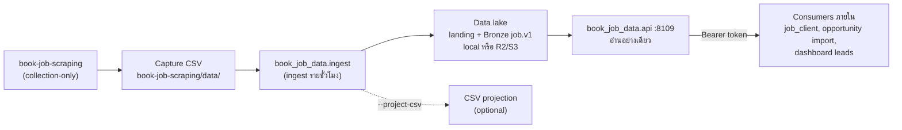
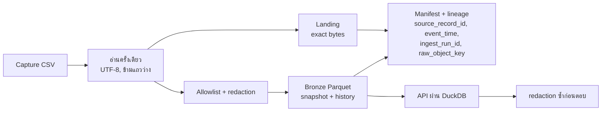
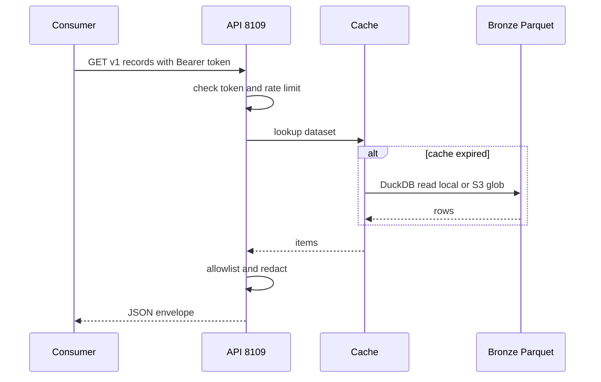
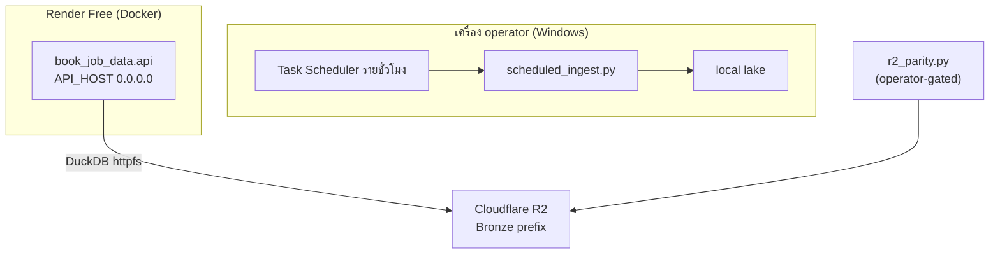

# Book Job Data — System Architecture

## 1. Context diagram

## 2. Components

| Component | ไฟล์ | หน้าที่ |
|---|---|---|
| Config | `src/book_job_data/config.py` | ค่าจาก environment, contract (`job.v1`, `jobs`, privacy `internal`, retention `operational`), datasets |
| Ingest CLI | `src/book_job_data/ingest.py` | อ่าน capture ครั้งเดียว, validate, dedupe input, จำแนก dataset จากชื่อไฟล์, เรียก lake |
| Lake adapter | `src/book_job_data/lake.py` | เขียน landing/Bronze ผ่าน `solo-empire-data-lake` (pinned commit) และอ่านกลับ |
| Privacy | `src/book_job_data/privacy.py` | `ALLOWED_FIELDS` + `redact_text` (อีเมล, เบอร์โทรรวมรูปแบบไทย) ใช้ทั้ง ingest และ API |
| Store | `src/book_job_data/store.py` | `stable_job_id`, `canonical_url`, CSV projection แบบ atomic |
| API | `src/book_job_data/api.py` | HTTP server (stdlib), auth, cache, rate limit, DuckDB อ่าน Parquet |
| Scheduled ingest | `scripts/scheduled_ingest.py`, `ops/windows/scheduled-ingest.ps1` | tick รายชั่วโมง, log ลง `data/ingest.log`, stale alert |
| R2 parity verifier | `scripts/r2_parity.py` | เขียน demo prefix แล้วตรวจ replay/manifest/idempotency |

## 3. เส้นทางข้อมูล (sources → ingestion → lake → API/consumers)

| Input file | Dataset |
|---|---|
| `job_postings.csv` และไฟล์อื่นที่ไม่เข้าเงื่อนไขด้านล่าง | `job_postings` |
| `matched_jobs.csv` | `job_matches` |
| `leads.csv`, `pipeline.csv`, ไฟล์ที่ชื่อมี `jobsdb_jobs` | `job_leads` |

## 4. Tech stack

- Python ≥ 3.11 (Docker `python:3.12-slim`, CI 3.12)
- `[lake]` extra: `duckdb>=1.1,<2`, `pyarrow>=14,<24`, `solo-empire-data-lake[lake]` pinned commit `4c24c66`
- HTTP server จาก standard library (ไม่มี web framework)
- ไม่มี dependency หลักใน `dependencies = []`; dev tools `pytest`, `ruff` ติดตั้งแยก

## 5. Data stores

| Store | ที่ตั้ง | เนื้อหา |
|---|---|---|
| Landing | `SOLO_EMPIRE_DATA_LAKE_URI` (local path หรือ `s3://`) | exact capture bytes เป็น replay evidence |
| Bronze | lake เดียวกัน | Parquet `job.v1` ต่อ dataset + history + manifest |
| Lineage | `lake_lineage.json` | ข้อมูลที่ `/v1/metadata` ส่งกลับ |
| Local data | `data/` (ignored) | `ingest.log`, CSV projection |
| R2 (hosted) | bucket/prefix ที่กำหนดผ่าน env | แหล่งถาวรเดียวของ hosted lane |

## 6. Integrations

| ระบบ | ทิศทาง | Contract |
|---|---|---|
| `book-job-scraping` | ขาเข้า (ไฟล์) | CSV ใน `data/`; ไม่มีการเรียก API |
| `solo-empire-data-lake` | library | pinned commit; MIT |
| Cloudflare R2 | storage | S3 API ผ่าน `DATA_LAKE_S3_ENDPOINT` |
| Consumers ภายใน | ขาออก (HTTP) | `job.v1` envelope; `job_client` fallback อ่าน Bronze ด้วย DuckDB |
| solo-data-lake readiness | ตรวจ | `task data:job:readiness` (`infra/scripts/data_lake/job_data_readiness.py`) |

## 7. Deployment topology

- Local: ingest เขียน local lake; API local bind loopback
- Hosted: Render อ่าน R2 อย่างเดียว ไม่ ingest; ยังไม่มีขั้นตอนอัตโนมัติที่ส่ง capture ใหม่เข้า R2 prefix ของ production **[ต้องยืนยัน]**
- Parallel service ใน Render verified 2026-08-09 ที่ commit `6942dbf` กับ demo prefix; service เดิมของ parent ยังเป็นตัวหลัก **[ต้องยืนยัน]**

## 8. ADR สำคัญ

| ID | การตัดสินใจ | เหตุผล | สถานะ |
|---|---|---|---|
| ADR-01 | Scraper เป็น collection-only; ส่งต่อด้วยไฟล์ | แยก boundary ไม่ให้เขียน DB ของกันและกัน | ใช้อยู่ |
| ADR-02 | API อ่าน Bronze เท่านั้น ไม่เปิด CSV, refresh ถูกห้าม | consumer ไม่ผูกกับ projection | ใช้อยู่ |
| ADR-03 | Redaction สองชั้น (ingest + response) | กันข้อมูลติดต่อหลุดแม้ Bronze เก่า | ใช้อยู่ |
| ADR-04 | `LAKE_READ_FALLBACK=error` | fail closed ไม่สลับแหล่งเงียบ ๆ | ใช้อยู่ |
| ADR-05 | ใช้ public `solo-empire-data-lake` pinned commit | รันนอก parent ได้ | ใช้อยู่ |
| ADR-06 | repo นี้เป็น canonical, สำเนา parent เป็น mirror | ลด drift | **[ต้องยืนยัน]** |

## การอนุมัติ

| บทบาท | สถานะ | วันที่ | ลงนาม |
|---|---|---|---|
| Solution Architect (Book Dev) | รอพิจารณา | — | ________ |
| Product owner (Book Dev) | รอพิจารณา | — | ________ |

## แหล่งข้อมูล

- `README.md`
- `pyproject.toml`
- `Dockerfile`
- `render.yaml`
- `src/book_job_data/config.py`
- `src/book_job_data/ingest.py`
- `src/book_job_data/api.py`
- `src/book_job_data/privacy.py`
- `scripts/scheduled_ingest.py`
- `ops/windows/scheduled-ingest.ps1`
- `(solo-empire) operations/evidence/BOOK-JOB-DATA-RENDER-CUTOVER.md`
- `(solo-empire) systems/ai-data/scraping-data-coverage.yaml`
